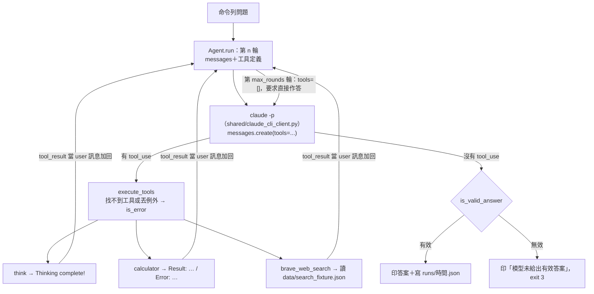

# 01-S1 agents 官方多工具代理迴圈

K904《Claude Quickstarts 官方範例版實作》第 1 段（共 5 段）。本段範例 S1 對應 K902 的第 3 章 agents，題材直接採用官方 `anthropics/claude-quickstarts` 裡實際示範的內容；模型一律透過 `claude -p` 呼叫（訂閱額度，不設 API 金鑰），拿不到的外部環境用本機假資料代替，標「虛構但照官方格式」。本來源分三部分：一、範例說明（做了什麼、三個靈魂拷問、架構、實跑結果、與官方差異）；二、規格（報告出處、完成定義、邊界案例、與 K903 生活題材版的差異）；三、互動演練教練稿（逐步敘述每一步要做什麼、會看到什麼）。

## 一、範例說明（s1-multi-tool-agent/README.md）

### S1 官方多工具代理（Multi-Tool Agent）

#### 1. 模仿哪一章

模仿官方 claude-quickstarts 第 3 章 `agents`。講義在 `~/workspace/kindle-902-claude-quickstarts/lessons/ch03-agents.md`，官方原始碼在 `~/workspace/claude-quickstarts/agents/`（只讀）。

題材照官方筆記本 `agent_demo.ipynb` 的「Multi-Tool Agent」：一個通用助理，有網路搜尋、計算機、思考三種工具，回答「要先查資料、再算數」的問題。問題也照官方原文：

- `What's the square root of the OKC population in 2022`
- `How many bananas will fit in an Toyota GR86?`

程式 `multi_tool_agent.py` 的 `Agent` 類別照官方 `agent.py` 的形狀（`name`、`system`、`tools`、`run(question)`）。迴圈也一樣：呼叫模型，取出 `tool_use` block，執行工具，把 `tool_result` 加回 messages，再呼叫模型，直到模型這一輪沒有要工具為止。

#### 2. 三個靈魂拷問

| 問題 | 答案 |
| --- | --- |
| 這個代理是給誰用的？ | 給自己用。在終端機一個人跑，有人看著，目的是看懂工具迴圈怎麼自己決定要查、要想、還是要算。 |
| 被賦予了哪些工具權限？ | **可以用的**：`think`（什麼都不做，只回 `Thinking complete!`）、`calculator`（純計算）、`brave_web_search`（只讀 `data/search_fixture.json`，不上網）。三個工具都沒有副作用。<br>**刻意不給的**：官方 `tools/file_tools.py` 裡的 `file_read`／`file_write`（筆記本沒用到）、上網、執行程式碼、寫檔。`claude -p` 用 `--tools ""` 啟動，模型本身碰不到電腦，工具一律由本程式代為執行。<br>**最壞情況**：模型算錯或引用錯的數字，印在終端機上。 |
| 資料和成果最後存在哪裡？ | 輸入是命令列上的問題。搜尋資料 `data/search_fixture.json` 進 git（內容是官方公開的存檔結果）。答案只印在終端機。迴圈紀錄寫在 `runs/<時間>.json`，內容有問題、每輪的工具名稱與參數、結果長度與首行、呼叫次數、是否為有效答案、答案是否與 calculator 一致。`runs/` 不進版控，也沒有個資。 |

#### 3. 架構與資料流



轉接層每次呼叫都是全新的 `claude -p` 行程，會把整串 messages（含 `tool_use`／`tool_result`）攤平成一份逐字稿重送。工具定義寫進系統提示，請模型用 `<tool_use>{...}</tool_use>` 標記回覆，再由轉接層解析成 `tool_use` block。模型是真的，但這不是 API 原生的 tool use。

#### 4. 怎麼跑（Git Bash）

```bash
cd ~/workspace/kindle-904-quickstarts-official-samples/s1-multi-tool-agent
PYTHONUTF8=1 python multi_tool_agent.py "What's the square root of the OKC population in 2022"
PYTHONUTF8=1 python multi_tool_agent.py "How many bananas will fit in an Toyota GR86?"
PYTHONUTF8=1 python multi_tool_agent.py --max-rounds 3 "<問題>"   # 觀察碰到上限時的行為
PYTHONUTF8=1 python multi_tool_agent.py --fix-prompt "<問題>"     # 系統提示改成正確工具名 calculator
PYTHONUTF8=1 python multi_tool_agent.py --dry-run "<問題>"        # 不呼叫模型，只檢查程式路徑
PYTHONUTF8=1 python multi_tool_agent.py --selftest                # 離線自我檢查
```

- 不需要任何 API 金鑰，前提是已經登入 Claude Code（Max 訂閱）。要換成較快的模型，可以設 `K902_CLI_MODEL=haiku`。
- `--max-rounds` 預設 6，指的是最多呼叫幾次模型。官方 OKC 題的存檔是 5 次（搜尋、搜尋、think、calculator、回答），多留 1 次餘裕。最後一輪不提供工具，並要求模型根據已有的結果作答。
- 結束碼：0 有效答案｜1 模型呼叫失敗（逾時、超過 `K902_CLI_MAX_CALLS`，不重試）｜2 用法錯誤（例如空問題）｜3 模型未給出有效答案。

#### 5. 實際跑出來的結果（2026-11-25，真模型 1 次）

指令：`K902_CLI_MAX_CALLS=6 PYTHONUTF8=1 python multi_tool_agent.py "What's the square root of the OKC population in 2022"`

```text
[Multi-Tool Agent] Tool call: brave_web_search(query=Oklahoma City population 2022 census estimate)
[Multi-Tool Agent] Tool result: Title: Oklahoma Cities by Population (2025) …（共 4148 字）
[Multi-Tool Agent] Tool call: brave_web_search(query=Oklahoma City population July 1 2022 Census Bureau estimate)
[Multi-Tool Agent] Tool result: Title: Oklahoma Cities by Population (2025) …（共 4148 字）
[Multi-Tool Agent] Tool call: calculator(number1=695178, number2=0, operator=sqrt)
[Multi-Tool Agent] Tool result: Result: 833.7733504976037

=== 答案 ===
The square root of Oklahoma City's 2022 population is about **833.77**.
- The 2023 Census estimate for Oklahoma City is **702,767**.
- The Oklahoman reported that the city added **7,589 people** between 2022 and 2023.
- So the 2022 population was about 702,767 − 7,589 = **695,178**.

模型呼叫 4 次（上限 6）｜有效答案：True｜答案與 calculator 一致：True｜耗時 19.6 秒
```

| 項目 | 官方存檔 | 本次實測 |
| --- | --- | --- |
| 步驟 | 搜尋 → 搜尋 → think → calculator → 回答（5 次呼叫） | 搜尋 → 搜尋 → calculator → 回答（4 次呼叫），沒有用 think |
| 2022 人口 | 683,078 × 1.0096² ≈ 696,272（自己推估的成長率） | 702,767 − 7,589 = 695,178（兩筆搜尋結果相減） |
| 答案 | √696,272 ≈ 834.43 | √695,178 ≈ 833.77 |

觀察：

- 同一份搜尋資料，模型這次選了不同的推算方式。兩次都是「推估」，因為存檔資料裡本來就沒有 2022 年的確切數字。
- 模型把 `Oklahoma Cities by Population (2025)` 那筆的 702,767 當成「2023 年人口普查局估計值」。資料標題寫的是 2025，這是模型自己的解讀。
- 答案最後一段還多寫了「最初的 2022 估計約 694,800」。這個數字不在任何工具結果裡，是模型自己知道的知識。
- 第二次搜尋換了查詢字串，但離線假搜尋仍然比對到同一組存檔結果（見第 6 節），所以兩次拿到的內容一樣。
- `--dry-run` 跑同一題：印出 4 個步驟，每步都標 `[dry-run]`，exit 0，沒有啟動 `claude` 子程序。

#### 6. 跟官方原版差在哪

| 項目 | 官方 `agents`＋`agent_demo.ipynb` | 本範例 |
| --- | --- | --- |
| 呼叫模型 | `anthropic` SDK＋金鑰，原生 tool use | `shared/claude_cli_client.py`（`claude -p`），用提示詞模擬 tool use |
| 迴圈上限 | `while True`，沒有上限（K902 第 3 章陷阱 1） | `--max-rounds`（預設 6），最後一輪不給工具 |
| 搜尋 | Brave Search MCP 伺服器，真的上網（要 `BRAVE_API_KEY`） | 離線假搜尋，讀官方存檔結果（共 4 組查詢、40 筆，每筆附筆記本行號 `source_line`） |
| 計算機 | Python MCP 伺服器 `calculator_mcp.py` | 同一支程式裡的 Python 函式，簽名、運算子、錯誤字串照官方，不走 MCP 協定 |
| `brave_local_search` | 有註冊，但存檔輸出裡沒呼叫過 | 不提供。系統提示照官方保留這個名稱，模型呼叫時回 `Tool 'brave_local_search' not found` |
| 多個工具呼叫 | `asyncio.gather` 平行 | 依序執行（工具都是瞬間完成的純函式） |
| 歷史截斷 | `MessageHistory.truncate()` 超過 context 就丟最舊的 | 不截斷（最多 6 輪，一題約 10 KB） |
| 伺服器端工具 | 筆記本第 4 節示範 `web_search`、`code_execution`（東京人口密度題） | **沒有對應**：轉接層會忽略沒有 `input_schema` 的工具，本範例不做東京題 |

幾個要照實說的地方：

- **離線搜尋的比對規則是本教材自己訂的，官方沒有載明。** 查詢至少要命中一個主題詞（oklahoma／okc、toyota／gr86、banana），才在同主題的存檔查詢裡挑字詞重疊最多的那組。所以兩次問法不同的 OKC 搜尋，常常拿到同一組 10 筆結果。Brave 實際怎麼排序，報告未載明。
- **問 fixture 沒有的題目**（例如「台北 2022 年人口開根號」），搜尋會回 `No results found.`。規格要求模型這時要說查不到、不能自己編人口數。這個情境本次只做了離線測試，沒有用真模型跑，模型會不會編數字尚未驗證。
- **`calculate` 陷阱**：官方系統提示寫 `calculate`，但實際註冊的名稱是 `calculator`。轉接層只認得已註冊的名稱，所以程式另外用 `recover_unknown_calls` 把 `calculate` 這類名稱撿回來，回傳 `Tool 'calculate' not found`（`is_error`），讓模型自己改正。本次實測模型直接用了正確的 `calculator`，沒有踩到這個陷阱。加 `--fix-prompt` 可以和正確版的提示詞對照。
- **官方未載明**：官方 OKC 題最後的文字答案全文（存檔是逐段串流輸出，沒有逐字核對），以及 Brave 搜尋的實際排序規則。`brave_web_search` 的工具說明文字在 npm 套件裡，不在官方 repo，本範例的說明是自己寫的。

正式上線要改：改用 API 原生 tool use；搜尋改接真的搜尋 API（金鑰放在專案 `.env`）；加上歷史截斷或摘要；檢查模型引用的數字是否真的出現在工具結果裡（本次就出現了工具結果以外的 694,800）。

#### 7. 模仿指南：改成自己的需求，改這 3 個地方

1. **`TOOLS` 字典**：每個工具是「給模型看的定義（name、description、input_schema）」加上「一個 Python 函式」。新增工具時兩樣都要有。
2. **`data/search_fixture.json`**：換成你自己的存檔資料（例如公司 FAQ 的搜尋結果），每筆保留 `query`、`title`、`description`、`url`。主題詞要一起改，改 `SUBJECT_WORDS`。
3. **`OFFICIAL_SYSTEM_PROMPT`**：改掉代理的角色。提示詞裡寫的工具名稱，一定要和 `TOOLS` 的名稱對得起來，不要重蹈 `calculate` 的覆轍。

## 二、規格（specs/s1.md）

### S1 規格：官方多工具代理（對應 K902 第 3 章 `agents`）

> 狀態：規格（尚未實作）。本份只定義要做什麼，程式由後續代理照本規格實作。
> 對照：K903 S1「本機資料夾小管家」（`~/workspace/kindle-903-quickstarts-samples/s1-agent-loop/`）。

#### 1. 報告出處

| 來源 | 路徑與行號 | 原文要點 |
| --- | --- | --- |
| 盤點報告 | `~/workspace/console/drills/anthropic-harness/quickstarts-repo-report.md` 第 58 行 | `agents`：教學用的最小代理實作（工具迴圈，核心邏輯不到 300 行），對應文章 Building effective agents；Python、`anthropic` SDK、MCP；預設模型 `claude-sonnet-5-5`；單代理；非長時間運行 |
| 盤點報告 | 同檔第 93 行 | 統計上歸類為「單代理」 |
| K902 講義 | `~/workspace/kindle-902-claude-quickstarts/lessons/ch03-agents.md` 第 55 行 | 迴圈結束條件只有一個：模型這一輪沒有要求任何工具；沒有最大輪數、沒有逾時 |
| K902 講義 | 同檔第 63、66、70 行 | `think` 工具只回 `Thinking complete!`；`calculator_mcp.py` 是示範用計算機 MCP 伺服器；`agent_demo.ipynb` 示範計算機 MCP、Brave 搜尋 MCP、think、伺服器端工具 |
| K902 講義 | 同檔第 122 行 | 工具丟例外會變成帶 `is_error` 的工具結果交還模型；多個工具呼叫預設 `asyncio.gather` 平行執行 |
| K902 講義 | 同檔第 190、193、195 行 | 常見陷阱：迴圈沒有上限；`truncate()` 直接丟資訊；筆記本系統提示寫 `calculate`，但實際註冊名稱是 `calculator` |
| 官方原始碼 | `~/workspace/claude-quickstarts/agents/README.md` 第 9 行 | 「LLMs using tools in a loop」，核心 <300 行，刻意不含正式環境功能 |
| 官方原始碼 | 同檔第 24～38 行 | 用法：`Agent(name, system, tools=[ThinkTool()], mcp_servers=[...])`，範例問題 `agent.run("What should I consider when buying a new laptop?")` |
| 官方原始碼 | `~/workspace/claude-quickstarts/agents/agent.py` 第 100～151 行 | `while True`：`history.truncate()` → `messages.create` → 取出 `tool_use` block → 有就 `execute_tools` 後把結果當 user 訊息加回、沒有就 `return response` |
| 官方原始碼 | `~/workspace/claude-quickstarts/agents/tools/think.py` 第 11～31 行 | `think` 工具定義：參數 `thought`（必填），執行只回 `"Thinking complete!"` |
| 官方原始碼 | `~/workspace/claude-quickstarts/agents/tools/calculator_mcp.py` 第 12～51 行 | `calculator(number1, number2, operator)`，運算子只接受 `+ - * / ^ sqrt` 符號；除以零、負數開根號、未支援運算子都回 `Error: ...` 字串；整數結果去掉小數 |
| 官方原始碼 | `~/workspace/claude-quickstarts/agents/agent_demo.ipynb` 第 10 行、第 108～126 行（系統提示在第 111～112 行） | 筆記本示範三種工具：Local Calculator（MCP）、Brave Search（MCP，需 `BRAVE_API_KEY`）、Think；系統提示列出 `brave_web_search, brave_local_search`、`calculate`、`think`；模型 `claude-sonnet-5-5`、`max_tokens=4096` |
| 官方原始碼 | 同檔第 298 行、第 312 行 | 兩個示範問題：「What's the square root of the OKC population in 2022」、「How many bananas will fit in an Toyota GR86?」 |
| 官方原始碼 | 同檔第 155、205、255、278 行 | OKC 題的存檔輸出：搜尋 2 次 → think 1 次 → `calculator(number1=696272, number2=0, operator=sqrt)` → 回答 |
| 官方原始碼 | 同檔第 316、360、410 行 | GR86 題的存檔輸出：搜尋 GR86 行李廂容積 → 搜尋香蕉尺寸 → think |

#### 2. 官方範例的題材與資料

- **題材**：官方筆記本的「Multi-Tool Agent」：一個通用助理，有網路搜尋、計算機、思考三種工具，回答「需要先查資料、再算數」的問題。示範題是 OKC 人口開根號、GR86 裝得下幾根香蕉。
- **官方實際用的工具**：
  - `think`（本機 Python 工具，無副作用）
  - `calculator`（Python MCP 伺服器 `tools/calculator_mcp.py`）
  - `brave_web_search`、`brave_local_search`（TypeScript MCP 伺服器 `@modelcontextprotocol/server-brave-search`，需 `BRAVE_API_KEY`）
  - 第二段（筆記本第 4 節）另示範伺服器端工具 `web_search`、`code_execution`，題目是東京人口密度。
- **拿不到的部分與替代方案**：
  1. Brave 搜尋需要 Brave API 金鑰且要上網，本教材不設任何金鑰。**替代**：`brave_web_search` 改成離線假搜尋，讀 `data/search_fixture.json`。資料內容**逐字取自官方筆記本已存檔的工具結果**（第 155～277 行 OKC 題、第 316～409 行 GR86 題），格式照官方 `Title: / Description: / URL:` 三行一筆。這份資料不是虛構，但「用查詢字串比對存檔結果」的搜尋邏輯是本教材的替代做法（官方原始碼未載明此做法）。fixture 每筆附 `source_line`（筆記本行號）。
  2. MCP：轉接層 `shared/claude_cli_client.py` 沒有 MCP 功能（`install_mcp_stub` 只是空殼）。**替代**：`calculator` 在同一支程式裡用 Python 函式實作，簽名、運算子、錯誤字串照 `calculator_mcp.py` 第 12～51 行，不走 MCP 協定。
  3. 伺服器端工具 `web_search`、`code_execution`：轉接層會忽略沒有 `input_schema` 的工具，無法重現。**本範例不做東京題**，README 要明說這段沒有對應。
  4. `brave_local_search`：存檔輸出裡沒有被呼叫過，沒有資料可用，**不提供**；系統提示照官方保留這個名稱與否由實作者決定，但若保留，呼叫時要回「本範例未提供」的錯誤結果。
- **官方未載明**：官方 OKC 題最後的文字答案全文（存檔是逐段串流輸出，未逐字核對）、Brave 搜尋的實際排序規則。

#### 3. 三個靈魂拷問預設答案

| 問題 | 預設答案 |
| --- | --- |
| 給誰用 | 使用者自己，在終端機一個人跑，有人看著。目的是看懂「工具迴圈」怎麼自己決定查、想、算。 |
| 工具權限 | **給**：`think`（不做任何事，只回 `Thinking complete!`）、`calculator`（純計算）、`brave_web_search`（只讀 `data/search_fixture.json`，不上網）。三個都沒有副作用。**刻意不給**：官方 `tools/file_tools.py` 裡有 `file_read`／`file_write`，但筆記本沒用，本範例也不給；不給上網、執行程式碼、寫檔。`claude -p` 以 `--tools ""` 啟動，模型本身碰不到電腦，工具一律由本程式代為執行。最壞情況：模型算錯或引用錯數字，印在終端機。 |
| 資料與成果放哪 | 輸入是命令列問題；搜尋資料 `data/search_fixture.json` 進 git（官方公開內容）；答案只印終端機；迴圈紀錄寫 `runs/<時間>.json`（問題、每輪工具名稱與參數、結果長度與首行、呼叫次數、是否有效答案），`runs/` 不進版控。無個資。 |

#### 4. 產出檔案清單與指令介面

資料夾：`s1-multi-tool-agent/`

| 檔案 | 內容 |
| --- | --- |
| `multi_tool_agent.py` | 單支主程式。`Agent` 類別照官方 `agent.py` 的形狀（`name`、`system`、`tools`、`run(question)`），迴圈用 `shared/claude_cli_client.py` 的 `Anthropic().messages.create(..., tools=[...])`，解析回傳的 `tool_use` block、執行工具、把 `tool_result` 加回 messages，直到沒有工具呼叫或到輪數上限 |
| `data/search_fixture.json` | 官方筆記本存檔的搜尋結果（OKC 2 次、GR86 2 次查詢），每筆 `query`、`title`、`description`、`url`、`source_line` |
| `README.md` | 照 K903 S1 README 的 7 節：模仿哪一章、三個靈魂拷問、架構與資料流（mermaid）、怎麼跑、實際結果、跟官方差在哪、模仿指南 |
| `runs/`（執行產物） | `<時間>.json`，不進版控 |

指令介面（Git Bash，在 `s1-multi-tool-agent/`）：

```bash
PYTHONUTF8=1 python multi_tool_agent.py "What's the square root of the OKC population in 2022"
PYTHONUTF8=1 python multi_tool_agent.py "How many bananas will fit in an Toyota GR86?"
PYTHONUTF8=1 python multi_tool_agent.py --max-rounds 3 "<問題>"     # 觀察到上限時的行為
PYTHONUTF8=1 python multi_tool_agent.py --dry-run "<問題>"          # 不呼叫模型
```

- `--max-rounds`：預設 6（官方 OKC 題存檔是 5 次模型呼叫：搜尋、搜尋、think、calculator、回答，留 1 次餘裕）。最後一輪不再提供工具，要求模型依已有結果作答。
- `--dry-run`：用寫死的假回覆走完「搜尋 → think → calculator → 回答」，畫面與紀錄標明 `[dry-run]`，不算演練。這是唯一不呼叫真模型的路徑。
- 系統提示預設**照抄官方筆記本**（含 `calculate` 這個與實際工具名不一致的寫法），以重現 K902 第 195 行的陷阱；加 `--fix-prompt` 改成正確名稱 `calculator` 做對照。
- 模型一律走 `shared/claude_cli_client.py`（`claude -p`）；不設 `ANTHROPIC_API_KEY`、不 mock 模型。換快模型用 `K902_CLI_MODEL=haiku`。

#### 5. 完成定義

1. `PYTHONUTF8=1 python ../shared/claude_cli_client.py --selftest` 通過（離線）。
2. `--dry-run` 跑完 OKC 題，印出 4 個步驟與 `[dry-run]` 標記，exit 0，且沒有啟動 `claude` 子程序。
3. **真模型跑一次 OKC 題**：至少呼叫一次 `brave_web_search` 與一次 `calculator`，答案中的數字與 `calculator` 回傳的結果一致；`runs/<時間>.json` 有紀錄。**呼叫上限 6 次**。
4. （選做）真模型跑 GR86 題一次，上限 6 次。整章演練合計不超過 **12 次**真模型呼叫。
5. README 第 5 節貼上實測輸出（步驟、呼叫次數、耗時）。

#### 6. 邊界案例

| # | 情境 | 預期行為 |
| --- | --- | --- |
| 1 | `calculator` 收到除以零、負數開根號、文字運算子（例 `"square root"`） | 照官方回 `Error: Division by zero`／`Error: Cannot take square root of negative number`／`Error: Unsupported operator '...'`，當成工具結果交還模型，迴圈不中斷 |
| 2 | 模型呼叫不存在的工具（例照提示詞寫的 `calculate`，或 `brave_local_search`） | 回帶 `is_error: true` 的工具結果（「沒有這個工具」），讓模型自行改正；紀錄寫下工具名稱 |
| 3 | 問 fixture 沒有的題目（例「台北 2022 年人口開根號」） | `brave_web_search` 回「無結果（本範例只有官方筆記本存檔的搜尋資料）」；模型應說查不到，不得自己編人口數。實測若模型仍編數字，README 第 6 節照實記錄 |
| 4 | 達到 `--max-rounds` 仍在要工具 | 最後一輪不提供工具、要求作答；仍無有效答案就印「模型未給出有效答案」，exit 3，紀錄 `valid_answer: false` |
| 5 | `claude -p` 逾時或觸發 `K902_CLI_MAX_CALLS` | 捕捉 `APIError`，印錯誤訊息與已完成輪數，紀錄照寫，exit 非 0；不重試 |
| 6 | 空問題或只有空白 | 不呼叫模型，印用法，exit 2 |

#### 7. 與 K903 版的差異

K903 S1 是「本機資料夾小管家」：題材是自己的 shopping-notes，三個工具都是唯讀檔案工具，工具協定是自訂 JSON（`{"tool"}`／`{"final"}`），走 `shared/llm_agent.py`。K904 S1 改用官方筆記本的 Multi-Tool Agent 題材與工具組（`think`、`calculator`、`brave_web_search`），問題也照官方原文，工具定義與錯誤字串照官方原始碼；呼叫改走 `shared/claude_cli_client.py` 的 SDK 形狀介面（`messages.create(tools=...)`、`tool_use`／`tool_result` block），更貼近官方 `agent.py` 的寫法。學習重點從「權限鎖在資料夾」轉成「官方迴圈本身：工具怎麼定義、錯誤怎麼回給模型、提示詞與工具名不一致會怎樣、沒有上限的迴圈要怎麼補」。兩版對照，就能分清哪些是官方設計、哪些是 K903 為了生活題材加的防護。

## 三、互動演練教練稿（逐步敘述）

K904 範例 S1 互動演練：官方多工具代理 Multi-Tool Agent（教練稿）

【第 1 步：這個範例模仿官方第 3 章的什麼】
S1 模仿的是官方第三章的 agents，題材直接用官方筆記本裡的「多工具代理」。官方的代理核心是一個 while True 迴圈：呼叫模型，有工具要求就執行，把工具結果加回對話，再呼叫一次。筆記本給它三個工具：網路搜尋、計算機、思考，題目是「奧克拉荷馬市二零二二年人口開根號」。畫面上的對照表一共七項：代理的形狀和迴圈都照官方，模型改走 claude 減 p；搜尋改成離線讀官方存檔的結果；計算機改成同一支程式裡的函式。最後從官方原始碼找出 while True 在第一百行。目的，是先知道 S1 哪裡照抄官方、哪裡因為沒有金鑰而替換。

【第 2 步：看工具定義和 calculate 陷阱】
第二步看工具。每個工具都是兩樣東西：給模型看的定義，包括名稱、說明、參數格式，再加一個 Python 函式。注意官方系統提示寫的是 calculate，可是真正註冊的名稱是 calculator，提示裡的 brave local search 也不存在。這就是講義第三章提到的陷阱：提示詞和工具定義對不起來。接著離線試計算機六次：開根號、除法、次方都正常；除以零、負數開根號、用英文字寫運算子，都回一段 Error 文字，不會讓程式當掉。目的，是看懂工具的錯誤要變成文字交還模型。

【第 3 步：看迴圈主程式】
第三步看 Agent 的 run，四十多行。每一輪呼叫模型，取出工具呼叫，執行工具，再把結果當成使用者訊息加回去；這一輪沒有要工具，就把文字當答案。和官方不一樣的地方有兩個：迴圈最多六輪，最後一輪不給工具、要求直接作答。畫面下半示範第二輪送給 claude 減 p 的逐字稿：因為每次都是全新的行程，轉接層要把整串對話攤平重送。目的，是看懂官方那個沒有上限的迴圈，我們補了什麼。

【第 4 步：實跑官方原題】
第四步會呼叫真的模型，最多六次，大約二十秒。題目照官方原文問奧克拉荷馬市二零二二年人口的平方根。看三件事：模型搜尋了幾次、有沒有用思考工具、最後計算機算出的數字跟答案對不對得上。之前實測是搜尋兩次、計算機一次、回答一次，總共四次；人口用二零二三年的七十萬兩千七百六十七，減掉一年增加的七千五百八十九，開根號大約八百三十三點七七。官方存檔是八百三十四點四三，因為推估方式不同。目的，是親眼看到模型自己決定查、想、算的順序。

【第 5 步：看 runs 資料夾的紀錄】
第五步不呼叫模型，讀上一步存下來的 JSON 紀錄。紀錄有模式、系統提示是哪一版、呼叫次數、耗時、是不是有效答案，還有答案跟計算機結果一不一致。每一輪記工具名稱、參數、結果字數和第一行，刻意不存搜尋結果全文，因為全文本來就在 data 資料夾。如果只跑過乾跑，就會看到檔名帶 dry run 的那一份。目的，是學會設計紀錄時，先想清楚查核需要哪些欄位。

【第 6 步：試邊界案例】
第六步全部離線。先丟四個錯的工具呼叫：calculate、brave local search、參數寫成中文、少了參數，全部變成標著錯誤的工具結果，迴圈不中斷。再搜尋台北人口，存檔裡沒有，就回「查不到」。接著用乾跑客戶端把輪數壓成二，看到第二輪送出的工具數是零。最後真的執行一次空問題，程式在呼叫模型之前就以結束碼二離開。目的，是記住模型的每個請求都可能出錯，錯誤要回給模型，而不是讓程式當掉。

【第 7 步：搜尋資料從哪來】
第七步看搜尋資料。總共四十筆，分成四組查詢，每筆都逐字取自官方筆記本已存檔的結果，並記下筆記本的行號。畫面抽三筆回官方檔案核對，三筆都對得上。比對規則是本教材自己訂的：查詢要命中主題詞，再挑字詞重疊最多的那組。所以兩個問法不同的查詢可能拿到同一組結果，真模型實測時第二次搜尋就是這樣。畫面最後印出香蕉題和修正版提示詞的指令，演練結束後可以自己跑。目的，是分清楚哪些是官方資料、哪些是我們的替代做法。

【第 8 步：三個靈魂拷問】
最後一步分兩半。前半只出題：這個代理給誰用、有哪些工具權限、資料和成果存在哪裡。請你先自己各用一兩句話回答，說完再說「繼續」。後半才顯示範例答案，直接從範例的說明文件讀出來。再列出改成給客戶用會怎麼變：使用者變成外部客戶，要限流、擋提示詞注入；搜尋要接真的網路，要金鑰、限網域，迴圈上限一定要留；紀錄要去識別化，模型也要改用伺服器上的 API。目的，是看懂 S1 安全，是因為三個工具都沒有副作用、搜尋不上網；一接上真的網路，模型引用的每個數字都要查核。這次實測就出現了一個工具結果裡沒有的數字。

