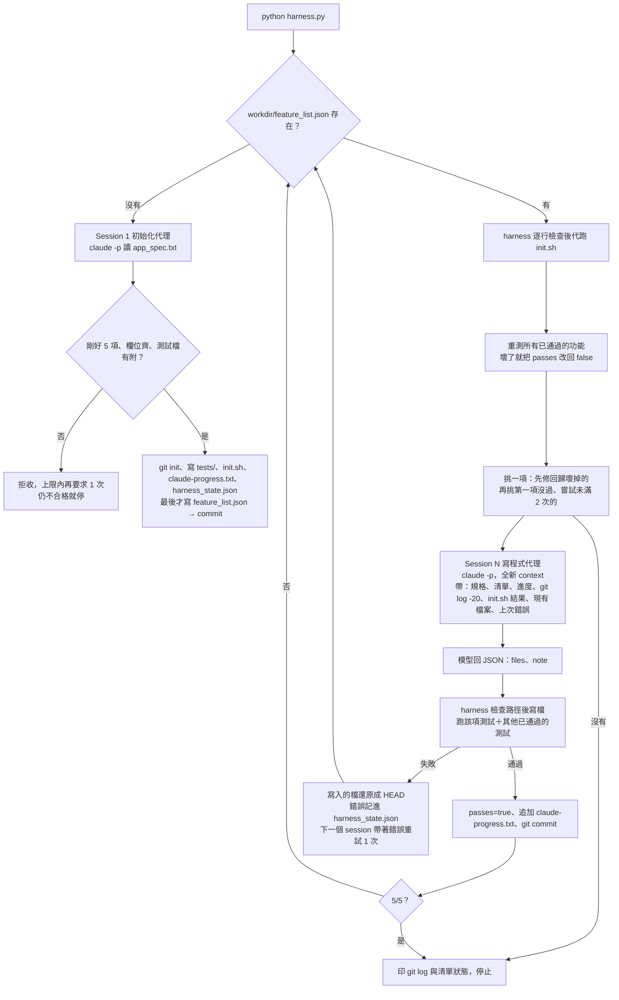

# 03-S3 autonomous coding 初始化代理與寫程式代理接力

K904《Claude Quickstarts 官方範例版實作》第 3 段（共 5 段）。本段範例 S3 對應 K902 的第 10 章 autonomous-coding，題材直接採用官方 `anthropics/claude-quickstarts` 裡實際示範的內容；模型一律透過 `claude -p` 呼叫（訂閱額度，不設 API 金鑰），拿不到的外部環境用本機假資料代替，標「虛構但照官方格式」。本來源分三部分：一、範例說明（做了什麼、三個靈魂拷問、架構、實跑結果、與官方差異）；二、規格（報告出處、完成定義、邊界案例、與 K903 生活題材版的差異）；三、互動演練教練稿（逐步敘述每一步要做什麼、會看到什麼）。

## 一、範例說明（s3-long-running/README.md）

### S3　官方 autonomous-coding 縮小版：讓代理接力寫出 claude.ai 複製品的「對話管理」資料層

#### 1. 模仿官方哪一章

- 對應官方 `claude-quickstarts/autonomous-coding`，導讀在 K902 講義 `~/workspace/kindle-902-claude-quickstarts/lessons/ch10-autonomous-coding.md`。
- 題材照官方：官方 `prompts/app_spec.txt` 是 claude.ai 複製品（679 行、200 項功能）。本範例只取官方規格自己切好的 `implementation_steps` 第 3 步「Conversation Management」（第 556～567 行），做成 5 項功能的 SQLite 資料層 `chat_store.py`。縮小版規格存在 `app_spec.txt`，沿用官方 XML 標籤，開頭註明出處。
- 一句話：初始化代理把 `app_spec.txt` 切成 5 項功能，寫好驗收測試和 `init.sh`；寫程式代理每個 session 先重測已通過的功能，再只做一項；harness 驗收、commit、寫交接。中斷後重跑同一條指令就接著做。

| 功能 | 官方規格原文 | 本範例的介面 |
| --- | --- | --- |
| F1 | Create new conversations／Conversation list in sidebar | `create_conversation`、`add_message`、`get_conversation`、`list_conversations`（`updated_at` 新到舊） |
| F2 | Rename conversations | `rename_conversation`（同時更新 `updated_at`） |
| F3 | Delete conversations（schema 有 `is_deleted`） | `delete_conversation`（軟刪除，列表與搜尋不再出現） |
| F4 | Search conversations by title/content | `search_conversations`（`%`、`_`、`\` 照字面比對，中文可搜） |
| F5 | grouped by date: Today, Yesterday, Previous 7 days, etc. | `group_by_date(conversations, now)`；第四組 `Older` 是自訂（官方只寫 etc.） |

#### 2. 三個靈魂拷問

| 問題 | 回答 |
| --- | --- |
| 做給誰用 | 給想對照官方原版、學「長時間任務怎麼分 session 接力」的自己，在終端機看著它跑。產出的 `chat_store.py` 是練習品，不對外、不上線。 |
| 工具權限 | **模型本身沒有任何工具**（`claude -p --tools ""`），只回 JSON（要寫哪些檔、內容是什麼）。寫檔、跑測試、跑 `init.sh`、commit 都由 harness 代做。<br>**harness 的護欄**：只准寫進 `workdir/`，擋 `..`、絕對路徑、`.git/`；`feature_list.json`、`claude-progress.txt`、`harness_state.json`、`app_spec.txt` 只有 harness 能寫；初始化代理只能寫 `tests/` 與 `init.sh`，寫程式代理不能改 `tests/`、`init.sh`；驗收指令只接受 `python -m unittest tests.<模組>`，不經 shell，60 秒逾時；`init.sh` 由初始化代理寫，但每一行都要通過白名單（`echo`、`python --version`、`python -m unittest`）harness 才逐行代跑，否則整份不跑（對照官方 `security.py` 第 44 行 init.sh 需額外檢查）。<br>**刻意不給**：不上網、不呼叫 Claude API、不讀任何金鑰檔；每項最多嘗試 2 次，一次執行最多呼叫模型 10 次。 |
| 資料與成果 | 全部在 `s3-long-running/workdir/`（獨立 git repo）：`app_spec.txt` 副本、`feature_list.json`、`claude-progress.txt`、`init.sh`、`tests/`、`chat_store.py`、git 歷史，以及 harness 專用的 `harness_state.json`（嘗試次數、上次錯誤）。測試用的 SQLite 在記憶體或暫存資料夾，測完即刪。外層 repo 的 `.gitignore` 排除 `workdir/`、`workdir.bak-*/`、`logs/`；5/5 完成版另存成進版控的 `snapshot-5of5/`。示範資料 `sample-conversations.json` 是虛構的，無個資。 |

用 `claude -p` 還是 API：只有自己用、量小（一次執行預期 6 次呼叫），失敗重跑即可，所以用 `claude -p`（訂閱額度）。

#### 3. 架構與資料流



session 之間唯一的橋樑是 `workdir/` 裡的交接檔，和官方一樣：`feature_list.json`（還剩哪些功能，只能改 `passes`）、`claude-progress.txt`（上一個 session 做了什麼）、git 歷史（存檔點）。本範例多一個 `harness_state.json` 記嘗試次數，讓清單維持官方的形狀。

#### 4. 怎麼跑（Git Bash）

```bash
cd ~/workspace/kindle-904-quickstarts-official-samples/s3-long-running
PYTHONUTF8=1 python harness.py --selftest                       # 離線檢查路徑、指令白名單、init.sh 檢查，不呼叫模型
rm -rf workdir                                                   # 想從頭來才需要
PYTHONUTF8=1 python harness.py                                   # 預設 --max-sessions 3 --max-calls 10
PYTHONUTF8=1 python harness.py                                   # 同一條指令再跑一次＝續跑
PYTHONUTF8=1 python harness.py --max-sessions 6 --max-calls 10   # 一次跑完
PYTHONUTF8=1 python harness.py --dry-run --workdir logs/dry-run-workdir   # 乾跑（假回覆取自 snapshot-5of5），不算演練
cd workdir && PYTHONUTF8=1 python -m unittest discover -s tests   # 全部驗收測試
```

| 參數 | 說明 | 預設 |
| --- | --- | --- |
| `--max-sessions N` | 這次最多跑幾個 session | 3 |
| `--max-calls N` | 這次最多呼叫模型幾次 | 10 |
| `--workdir PATH` | 產出資料夾 | `workdir/`（乾跑時 `logs/dry-run-workdir`） |
| `--dry-run` | 不呼叫模型，用 `snapshot-5of5/` 當寫死的假回覆走完流程；畫面標明【乾跑模式】；拒絕寫進真正的 `workdir/` | 關 |
| `--selftest` | 離線單元檢查 | 關 |

模型用 Claude Code 的預設模型，要換就設 `K902_CLI_MODEL=haiku`。harness 把單次逾時設成 300 秒（`K902_CLI_TIMEOUT`）。

**新電腦先看這裡**：`workdir/` 不進版控，clone 下來時不存在。要演練或查看 5/5 完成版，不必重跑 harness，從快照重建即可（不呼叫模型）：

```bash
cd ~/workspace/kindle-904-quickstarts-official-samples/practice/interactive
bash s3.sh seed      # 複製 snapshot-5of5 → workdir，git init，一個 commit（workdir 已存在就什麼都不做）
```

互動演練：`bash s3.sh 1` … `bash s3.sh 8`、`bash s3.sh 8b`，教練稿在 `practice/interactive/coach-s3.txt`。

#### 5. 實際跑出來的結果（2026-11-25，真模型 `claude -p`）

完整紀錄在 `logs/run1.txt`～`run3.txt`（不進版控）。

第 1 次，從空的 workdir 開始，預設 3 個 session，約 1 分 40 秒：

```text
Session 1：初始化代理（讀 app_spec.txt → feature_list.json、tests/、init.sh）
  → 功能 5 項：F1, F2, F3, F4, F5 → commit 6bd621b
Session 2：處理功能 F1 建立對話、新增訊息、取得對話，以及依 updated_at 由新到舊列出側邊欄對話清單。…
  → 測試結果：通過 → commit 39be2eb
Session 3：處理功能 F2 重新命名對話。測試驗證 rename_conversation 會 strip 標題、更新 updated_at…
  → 測試結果：通過 → commit 0f8aa06

本次模型呼叫：3 次（上限 10）
== feature_list.json 狀態：2/5 ==
```

第 2 次，同一條指令，從 Session 4 接著做（每個 session 先重測已通過的功能），約 1 分鐘：

```text
Session 4：處理功能 F3 軟刪除對話。…            → 測試結果：通過 → commit 925f1ab
Session 5：處理功能 F4 依標題或訊息內容搜尋對話。… → 測試結果：通過 → commit 38251ce
Session 6：處理功能 F5 依日期分組對話清單。…      → 測試結果：通過 → commit dbbd407
全部通過：5/5，停止（官方原版沒有這個判斷）

本次模型呼叫：3 次（上限 10）
== git log --oneline ==
dbbd407 完成 F5：依日期分組對話清單。…
38251ce 完成 F4：依標題或訊息內容搜尋對話。…
925f1ab 完成 F3：軟刪除對話。…
0f8aa06 完成 F2：重新命名對話。…
39be2eb 完成 F1：建立對話、新增訊息、取得對話，…
6bd621b Initial setup: feature_list.json, init.sh, and project structure（初始化）
== feature_list.json 狀態：5/5 ==
```

第 3 次再跑，不呼叫模型：`沒有可做的功能了：已完成 5/5 項`、`本次模型呼叫：0 次`。

- 兩次執行合計呼叫模型 **6 次**（初始化 1＋五項各 1），符合規格預期；上限是單次 10、合計 12。
- 初始化代理寫了 5 個測試模組共 49 個測試（`tests/test_f1.py`～`test_f5.py`），`python -m unittest discover -s tests` 全部通過。
- 5 項都是第一次就通過，所以「拒收後重要求」「失敗後帶錯誤重試」「回歸壞掉改回 false」這三條路徑在真模型實跑中**沒有被觸發**；它們另外用離線假回覆驗證過（selftest，以及在暫存資料夾故意弄壞 `chat_store.py`：回歸測試把 F1～F3、F5 改回 false，修好 F1 後其餘重測恢復）。
- 真模型實跑之後，harness 補了一項小改動：回歸壞掉的其他功能，在目標功能修好後會自動重測一次，恢復就標回通過。這條路徑真模型實跑沒走到。
- `init.sh` 是初始化代理寫的，內容只有 `echo`、`python --version`、`python -m unittest discover -s tests`，全部通過白名單，每個寫程式 session 都由 harness 逐行代跑。

用代理寫出的 `chat_store.py` 跑示範資料（`sample-conversations.json`，現在＝2026-11-25 10:00，互動演練第 7 步）：

```text
【F4】search_conversations（刪除前）
  '50%'      → ['要刪除的測試對話', '折扣怎麼算']        ← 「50 percent」那筆沒命中
  '_'        → ['SQL LIKE 的 _ 萬用字元']
  '太魯閣'   → ['花蓮三天兩夜行程']
【F5】group_by_date
  Today            ['長時間代理讀書心得（2026-11-25）', '花蓮三天兩夜行程（2026-11-25）']
  Yesterday        ['折扣怎麼算（2026-11-24）']             ← 23:59 跨午夜
  Previous 7 days  ['SQL LIKE 的 _ 萬用字元（2026-11-20）']
  Older            ['上個月的會議紀錄（2026-11-10）']
```

#### 6. 跟官方原版差在哪

| 項目 | 官方 autonomous-coding | 本範例 |
| --- | --- | --- |
| 題材與規模 | claude.ai 複製品，至少 200 項，React＋Express＋SQLite，要跑 many hours | 同一份規格的第 3 步，5 項，Python `sqlite3` 資料層 |
| 模型怎麼呼叫 | Claude Agent SDK，要 `ANTHROPIC_API_KEY`（規格本身還要 Claude API 金鑰） | `claude -p`，透過 `shared/llm_agent.py`，不設任何金鑰 |
| 模型的權限 | Read、Write、Bash、Puppeteer，靠沙箱、`./**` 限制、Bash 允許清單 hook | 沒有任何工具，只回 JSON；寫檔、跑指令都由 harness 代做 |
| 驗收 | Puppeteer 瀏覽器截圖 | `python -m unittest tests.test_fN` |
| 交接檔 | `app_spec.txt`、`feature_list.json`、`claude-progress.txt`、`init.sh`、git | 同名同用途；另加 `harness_state.json` |
| 清單防竄改 | 只靠提示詞「只能改 passes」（陷阱 2） | 清單只有 harness 能寫；`tests/` 鎖住 |
| 回歸測試 | 提示詞第 3 步叫模型重測 1～2 條 | harness 每個 session 重測全部已通過的，壞了自動改回 false |
| 何時停 | 只看 `max_iterations`（陷阱 1） | 全部通過就停；另有 `--max-calls` |
| 重試 | 出錯就開新 session，次數不限 | 每項最多 2 次，用完標 GAVE-UP |
| 初始化中斷 | 會被當成接續（陷阱 6） | `feature_list.json` 最後才寫，先寫暫存檔再改名 |
| `init.sh` | 模型自己跑，另有額外檢查 | 模型寫、harness 逐行白名單檢查後代跑 |

**正式上線要改什麼**：

1. 驗收指令要放進真正的沙箱（容器或低權限帳號）。目前只過白名單，被測的 Python 程式本身仍能存取整台電腦。
2. 初始化代理寫的測試要先由人審一次。測試寫錯，後面的功能就永遠過不了，或用錯的行為過關。
3. 專案變大後不能把所有檔案塞進提示詞（目前上限 4 萬字），要改成讓模型用工具按需讀檔。
4. 每次嘗試前開分支，失敗就丟掉，比現在的「還原寫入的檔」更乾淨。

#### 7. 模仿指南：改成自己的需求，改這 3 個地方

1. **`app_spec.txt`**：換成你要的規格。一定要寫清楚 `<interface>`（檔名、方法名、回傳格式、例外），因為測試和實作由不同 session 寫，靠它對齊。想換官方規格的其他步驟（例如第 4 步 Artifacts），就照它的 tasks 改 `core_features`。
2. **`harness.py` 的 `INIT_PROMPT` 與 `FEATURE_COUNT`**：改功能數量與測試要求。換測試框架時，`parse_test_command` 與 `check_init_sh` 的白名單要一起改。
3. **`harness.py` 的 `CODE_PROMPT`**：改寫程式代理的規則，例如允許的套件、程式風格、交接筆記要寫什麼。

## 二、規格（specs/s3.md）

### S3 規格：官方 autonomous-coding 縮小版（claude.ai 複製品的「對話管理」切片）

> 狀態：規格（尚未實作）。實作資料夾 `s3-long-running/`，與 K903 同名，方便兩版對照。
> 對應官方章：K902 第 10 章 `autonomous-coding`。K903 對應範例：`~/workspace/kindle-903-quickstarts-samples/s3-long-running/`。

#### 1. 報告出處

| 來源 | 位置 | 要點 |
| --- | --- | --- |
| 盤點報告 | `~/workspace/console/drills/anthropic-harness/quickstarts-repo-report.md` 第 105～107 行 | 全 repo 唯一明確為長時間運行設計的專案；README 第一句自稱 minimal harness |
| 同上 | 第 109～116 行 | 兩種角色輪流開新 session：初始化代理（只跑第 1 個 session，看 `feature_list.json` 存不存在）、寫程式代理（固定十步，每次全新 context） |
| 同上 | 第 118～127 行 | 交接檔：`app_spec.txt`、`feature_list.json`（只能把 `passes` 由 false 改 true）、`claude-progress.txt`、`init.sh`、git 提交紀錄、`.claude_settings.json` |
| 同上 | 第 129～135 行 | harness 迴圈：每輪新 client、出錯就新 session 重試、沒有「全部通過就停」、`max_turns=1000` |
| 同上 | 第 137～139 行 | 安全三層：沙箱、檔案限專案資料夾、Bash 允許清單（`pkill`、`chmod`、`init.sh` 另有檢查） |
| 同上 | 第 150～153、161～171 行 | 200 項功能要「many hours」；README 建議把功能數改成 20～50；原版需要 `ANTHROPIC_API_KEY`（本教材不設） |
| 同上 | 第 122 行 | 內建規格是 claude.ai 聊天介面的複製品 |
| K902 講義 | `~/workspace/kindle-902-claude-quickstarts/lessons/ch10-autonomous-coding.md` 第 149～161 行 | 兩種角色分工表；「只完成一項也沒關係」「結束前把程式庫留在乾淨狀態」 |
| 同上 | 第 194～203 行 | 陷阱 1～8（無完成判斷、清單防竄改只靠提示詞、重試無上限、初始化中斷被當接續等） |
| 官方原始碼（只讀） | `~/workspace/claude-quickstarts/autonomous-coding/prompts/initializer_prompt.md` 第 12～57 行 | `feature_list.json` 格式：`category`、`description`、`steps`、`passes`；至少 200 項；不可刪改，只能改 `passes` |
| 同上 | `initializer_prompt.md` 第 59～77、93～99 行 | `init.sh` 三件事（裝依賴、啟動服務、印存取方式）；首次 commit 訊息；收尾寫 `claude-progress.txt` |
| 同上 | `prompts/coding_prompt.md` 第 6～160 行 | 十步：了解現況 → `init.sh` → 第 3 步重測 1～2 條已通過功能（壞了要立刻改回 false，第 46～57 行）→ 挑一項 → 實作 → 瀏覽器驗證 → 只改 `passes` → commit → 更新進度 → 乾淨收尾 |
| 同上 | `security.py` 第 15～44 行 | Bash 允許清單與 `COMMANDS_NEEDING_EXTRA_VALIDATION` |
| 同上 | `agent.py` 第 20、150～181 行 | `AUTO_CONTINUE_DELAY_SECONDS = 3`；只有 `max_iterations` 能停 |

#### 2. 官方範例的題材與資料，以及怎麼縮小

##### 官方原題材

`prompts/app_spec.txt`（679 行，XML 格式）：「Claude.ai Clone - AI Chat Interface」（第 2 行）。React＋Vite 前端、Node.js＋Express＋SQLite 後端、SSE 串流、呼叫 Claude API（第 12～36 行）；測試金鑰在 `/tmp/api-key`、`.env` 的 `VITE_ANTHROPIC_API_KEY`（第 13～15、40 行）。功能涵蓋聊天、artifacts、對話管理、專案、模型選擇等十餘類（第 47～197 行），初始化代理要展開成至少 200 條端到端測試。

##### 為什麼不能照原樣做

- 一次演練預算是 `claude -p` 最多 10 次呼叫；200 項功能的網頁應用要「many hours」（報告第 153 行）。
- 原規格本身需要 API 金鑰與 Claude API，違反本教材「不設 ANTHROPIC_API_KEY」的規定。
- 原版靠 Puppeteer MCP 做瀏覽器驗證，本範例模型沒有工具（`--tools ""`）。

##### 縮小方式：只取官方 `implementation_steps` 第 3 步「Conversation Management」

官方規格自己把實作切成步驟，第 3 步就是一個可獨立驗收的後端切片（`app_spec.txt` 第 556～567 行）。本範例只做這一步的資料層，**縮小版，照官方格式**：

| 功能 | 對應官方規格原文 | `app_spec.txt` 行號 |
| --- | --- | --- |
| F1 建立對話、列出對話（依 `updated_at` 新到舊） | Create conversation list in sidebar／Implement new conversation creation；Create new conversations／Conversation list in sidebar | 559～560；77～78 |
| F2 重新命名對話（同時更新 `updated_at`） | Build conversation rename functionality；Rename conversations | 562；79 |
| F3 刪除對話（軟刪除：設 `is_deleted`，列表與搜尋不再出現） | Implement delete with confirmation；Delete conversations；schema `is_deleted` | 563；80；218 |
| F4 依標題或訊息內容搜尋對話 | Add conversation search；Search conversations by title/content；`GET /api/search/conversations?q=query` | 564；81；343 |
| F5 依日期分組（Today、Yesterday、Previous 7 days…） | Create conversation grouping by date；Conversations list (grouped by date: Today, Yesterday, Previous 7 days, etc.) | 565；393 |

資料表只取 `conversations` 與 `messages` 兩張表的部分欄位（第 215～229 行）：

- `conversations`：`id`、`title`、`created_at`、`updated_at`、`is_deleted`（`user_id`、`project_id`、`model`、`is_archived`、`is_pinned`、`settings`、`token_count`、`message_count` 不做）。
- `messages`：`id`、`conversation_id`、`role`、`content`、`created_at`（F4 搜尋內容時才需要）。

刻意不做的部分：前端、Express、SSE、Claude API 代理（第 372～377 行）、artifacts、專案、匯出、自動產生標題（第 521 行）、「delete with confirmation」的確認對話框（屬介面，資料層無從驗收）。

##### 改用的技術與資料

- 官方後端是 Node.js＋`better-sqlite3`；本範例改成 Python 3 標準庫的 `sqlite3`，同樣是 SQLite，不必裝任何套件。產出模組 `chat_store.py`。
- 驗收從「瀏覽器截圖」改成 `python -m unittest`，測試資料在測試內用暫存資料庫產生。
- 對話與訊息的測試資料為**虛構但照官方格式**（欄位名照第 215～229 行的 schema）。
- F5 的分組：官方只列出 Today、Yesterday、Previous 7 days 三組，後面寫「etc.」。其餘分組名稱與邊界**報告未載明**；本範例自訂第四組 `Older`（超過 7 天），並在 `app_spec.txt` 標明是自訂。日期分組要可測，所以函式收一個 `now` 參數，不讀系統時鐘。

縮小後的規格存成 `s3-long-running/app_spec.txt`，沿用官方 `<project_specification>` XML 標籤結構（`project_name`、`overview`、`technology_stack`、`core_features`、`database_schema`、`implementation_steps`、`success_criteria`），開頭註明「縮小版，照官方格式，原文出自 claude-quickstarts autonomous-coding/prompts/app_spec.txt 第 556～567 行」。

#### 3. 三個靈魂拷問（預設答案）

| 問題 | 預設答案 |
| --- | --- |
| 做給誰用 | 想對照官方原版、學「長時間任務怎麼分 session 接力」的自己，在終端機看著它跑。產出的 `chat_store.py` 是練習品，不對外、不上線。 |
| 工具權限 | 模型本身沒有工具（`claude -p --tools ""`），只回 JSON（要寫哪些檔、內容）。寫檔、跑測試、commit 都由 harness 代做：只准寫進 `workdir/`，擋 `..`、絕對路徑、`.git/`；`feature_list.json`、`claude-progress.txt` 只有 harness 能寫；寫程式代理不能改 `tests/`；驗收指令只接受 `python -m unittest tests.<模組>`，不經 shell，60 秒逾時；`init.sh` 由初始化代理寫，但 harness 只在每一行都通過同一份白名單時才執行（對照官方 `init.sh` 需額外檢查，`security.py` 第 44 行）。不上網、不呼叫 Claude API、不讀任何金鑰檔。 |
| 資料與成果存哪 | 全部在 `s3-long-running/workdir/`（獨立 git repo）：`app_spec.txt` 副本、`feature_list.json`、`claude-progress.txt`、`init.sh`、`tests/`、`chat_store.py`、git 歷史，以及 harness 專用的 `harness_state.json`（嘗試次數、上次錯誤）。測試用的 SQLite 檔在暫存資料夾，測完即刪。外層 repo 以 `.gitignore` 排除 `workdir/`、`workdir.bak-*/`；5/5 完成版另存進版控的 `snapshot-5of5/`。資料皆為虛構，無個資。 |

#### 4. 產出檔案清單與指令介面

沿用 K903 S3 的架構，檔名改回官方名稱。

```text
s3-long-running/
  README.md               照 K903 S3 的 7 節結構（模仿哪章、三問、架構圖、怎麼跑、實跑結果、跟官方差在哪、模仿指南）
  app_spec.txt            縮小版官方規格（XML 標籤照官方）
  harness.py              兩階段 harness（模型呼叫一律走 shared/llm_agent.py）
  sample-conversations.json  虛構測試資料（照官方 schema 欄位），給 README 示範用
  snapshot-5of5/          5/5 完成版的工作樹快照（進版控）＋ git-log.txt
  logs/                   實跑紀錄 run1.txt…（不進版控）
  workdir/                產出的專案（不進版控）
    app_spec.txt  feature_list.json  claude-progress.txt  init.sh
    chat_store.py  tests/__init__.py  tests/test_f1.py … test_f5.py
    harness_state.json
```

`feature_list.json` 每一項：官方四個欄位 `category`、`description`、`steps`、`passes`，外加本範例的 `id`（F1～F5）與 `test_command`（驗收指令）。嘗試次數與錯誤不放進清單，放 `harness_state.json`，讓清單維持官方「只改 `passes`」的形狀。

指令（Git Bash，在 `s3-long-running/`）：

```bash
PYTHONUTF8=1 python harness.py --selftest                  # 離線檢查路徑、指令白名單、init.sh 檢查，不呼叫模型
PYTHONUTF8=1 python harness.py                             # 預設 --max-sessions 3 --max-calls 10
PYTHONUTF8=1 python harness.py                             # 同一條指令再跑一次＝續跑
PYTHONUTF8=1 python harness.py --max-sessions 6 --max-calls 10   # 一次跑完
PYTHONUTF8=1 python harness.py --dry-run --workdir logs/dry-run-workdir   # 用寫死的假回覆走完流程，畫面標明乾跑
```

| 參數 | 說明 | 預設 |
| --- | --- | --- |
| `--max-sessions N` | 這次最多跑幾個 session | 3 |
| `--max-calls N` | 這次最多呼叫模型幾次 | 10 |
| `--workdir PATH` | 產出資料夾 | `workdir/` |
| `--dry-run` | 不呼叫模型，只檢查 harness 路徑（唯一不走真模型的例外） | 關 |
| `--selftest` | 離線單元檢查 | 關 |

每個寫程式 session 的流程對照官方十步：讀清單與 `claude-progress.txt` 與 `git log --oneline -20` 帶進提示詞 → harness 跑 `init.sh` → **重測已通過的功能**（官方第 3 步；任何一項變紅就把它的 `passes` 改回 false、記進進度檔，這一輪改修它）→ 挑第一項未通過且嘗試未滿 2 次的功能 → 模型回 JSON → harness 寫檔、跑該項測試 → 通過才把 `passes` 改 true、commit、追加 `claude-progress.txt`。全部通過就停。

互動演練腳本（之後另寫）沿用 K903：`practice/interactive/s3.sh` 的 `seed`（從 `snapshot-5of5` 重建 workdir，不呼叫模型）、`restore`（`workdir.bak-5of5` → `workdir`）、第 5、6 步呼叫真模型、`--dry-run`。

#### 5. 完成定義

1. `PYTHONUTF8=1 python harness.py --selftest` 通過。
2. 從空的 `workdir/` 用真模型（`claude -p`，不設任何 API 金鑰、不 mock）跑一次：`harness.py` 預設 3 個 session 中斷，再用同一條指令續跑到結束。最後 `feature_list.json` 為 5/5 PASS，或沒通過的項目明確標 GAVE-UP 並在 README 據實記錄。
3. **呼叫次數上限：單次執行 10 次（`--max-calls 10`）**。預期 6 次（初始化 1＋五項各 1）；兩次執行合計不得超過 12 次（每項最多重試 1 次，超過即 GAVE-UP）。
4. `git log --oneline` 看得到「初始化」加上每項功能各一個 commit；`claude-progress.txt` 每個 session 都有一段交接。
5. `cd workdir && python -m unittest discover -s tests` 全部通過。
6. `--dry-run` 跑得完，產出只寫到指定的暫存 workdir，不動真正的 `workdir/`。
7. 把 5/5 完成版存成 `snapshot-5of5/`，README 第 5 節貼實跑節錄（呼叫次數、commit、清單狀態）。

#### 6. 邊界案例

| # | 情況 | 預期處理 |
| --- | --- | --- |
| 1 | 初始化代理回的功能數不是 5 項（官方提示詞要求至少 200 項，模型可能照官方習慣多切） | harness 拒收，不寫 `feature_list.json`；在呼叫上限內重新要求一次，仍不符就停並印原因 |
| 2 | 初始化中途被中斷，留下半份清單（官方陷阱 6，講義第 201 行） | `feature_list.json` 最後才寫，且先寫暫存檔再改名；沒有完整清單就視為尚未初始化 |
| 3 | 寫程式代理想寫 `feature_list.json`、`claude-progress.txt`、`tests/`、`.git/`，或路徑含 `..`、絕對路徑 | 整個回覆拒收、記進 `harness_state.json` 的 last_error，不 commit，算一次嘗試 |
| 4 | 重測時發現先前通過的功能壞了（官方 `coding_prompt.md` 第 46～57 行） | 把該項 `passes` 改回 false、進度檔記一筆，本輪優先修它；修不好就 GAVE-UP |
| 5 | F4 搜尋字串含 SQL 萬用字元或引號（`%`、`_`、`'`）與中文 | 測試要求參數化查詢且跳脫萬用字元，搜尋 `50%` 只命中含字面 `50%` 的對話；中文標題與內容以 UTF-8 正確比對 |
| 6 | F5 跨午夜與「剛好 7 天」的邊界 | 分組以傳入的 `now` 的日期為準；邊界歸屬寫在縮小版 `app_spec.txt`（官方未載明，自訂並標註），測試照它驗 |
| 7 | `init.sh` 內含白名單以外的指令（例如 `rm`、`curl`） | harness 不執行，記錯誤並在進度檔提醒；不影響已通過功能的狀態 |

#### 7. 與 K903 版的差異

K903 的 S3 自己出題（記帳 CSV 月統計 CLI，`app_spec.md`、`progress.md`、`ledger.py`、4 項功能），重點是用生活題材看懂「規劃加接力」。K904 改用官方原題材：直接從官方 `app_spec.txt` 的 claude.ai 複製品裡，取官方自己切好的 `implementation_steps` 第 3 步「對話管理」，做成 5 項功能的 SQLite 資料層；檔名改回官方的 `app_spec.txt`（XML 結構）、`claude-progress.txt`、`init.sh`，清單欄位照官方的 `category`／`description`／`steps`／`passes`。流程上補上 K903 留給「正式上線」的一項：每個 session 先重測已通過功能（官方第 3 步），壞了就改回 false。這樣學的人可以把 K904 的產物直接對照官方原始碼與提示詞，看出「縮小了什麼、保留了什麼」，再回頭看 K903 理解同一套 harness 如何換成自己的題材。

## 三、互動演練教練稿（逐步敘述）

K904 範例 S3 互動演練：官方 autonomous-coding 縮小版，讓代理接力寫出 claude.ai 複製品的對話管理資料層（教練稿）

【開始前：新電腦先重建產出資料夾】
產出資料夾不進教材的版控，所以新電腦剛 clone 下來時沒有它。先執行 bash s3.sh seed，從快照資料夾把五項完成的版本複製回來，重新建一個 git，用一個 commit 存起來，不會呼叫模型。不先跑也沒關係，第三、四、七步和還原指令發現資料夾不在，會自動重建。差別只有一個：重建出來的 git 紀錄只有一筆，所以第三步會改顯示快照裡保存的原本六筆紀錄。

【第 1 步：長時間工作的難處】
S3 模仿官方第十章的 autonomous-coding，這是整個 quickstarts 唯一為長時間運行設計的專案。官方原題材是 claude.ai 的複製品，至少兩百項功能，要跑好幾個小時，還需要 API 金鑰。S3 只取官方規格自己切好的第三步「對話管理」，做成五項功能的資料層。表格把四個難處對到官方和 S3 的做法：context 會滿，所以每個 session 都是全新的；會中斷，所以狀態寫在交接檔和 git；會自我放水，所以清單和測試由 harness 鎖住；會改壞舊功能，所以每個 session 先重測已通過的。目的，是先知道為什麼長時間任務要拆成兩種角色接力。

【第 2 步：看縮小版規格和兩階段結構】
第二步只讀檔，不呼叫模型。縮小版規格沿用官方的 XML 標籤，像專案名稱、技術堆疊、資料表、實作步驟，畫面列出它們，並印出官方第三步的五個工作項目。本範例多加一段介面，把方法名、回傳的欄位、例外型別都寫死，因為測試和程式由不同的 session 寫，靠它對齊。接著看 harness 的五個函式和行號：初始化、回歸測試、挑功能、寫程式，還有外層的 run。run 每一圈只判斷一件事：沒有功能清單就初始化，有就跑一個寫程式的 session，全部通過就停，這一點官方原版沒有。目的，是看懂兩階段就是外層迴圈裡的一個 if。

【第 3 步：交接檔】
第三步讀現在的產出資料夾，演練前是五項全部完成的版本。功能清單照官方格式，是一個陣列，每項有類別、說明、測試步驟、是否通過四個欄位，本範例再加編號和驗收指令。嘗試次數和上次的錯誤另外放在 harness 狀態檔，讓清單維持官方「只能改通過與否」的形狀。進度檔記錄每個 session 的交接，git 紀錄是初始化加上每項功能各一個 commit。最後 harness 推算出下一個是第七個 session，但已經沒有功能可做，重跑也不會呼叫模型。目的，是記住記憶不在模型裡，在檔案裡。

【第 4 步：權限護欄】
第四步不呼叫模型，先跑 harness 的自我測試，結束碼零代表規則都正常。接著看三張表。第一張是寫檔路徑：一般程式檔放行；跳出資料夾、絕對路徑、git 內部檔都擋；清單、進度檔、狀態檔只有 harness 能寫；寫程式代理不能改測試和 init.sh，初始化代理也不能先寫好程式。第二張是驗收指令，只接受 python 減 m unittest 加測試模組，其他像直接執行程式、裝套件、用分號串指令、改用 bash 都擋。第三張是 init.sh：官方的 init.sh 本來就要額外檢查，S3 規定每一行都要在白名單裡，像印字、看 Python 版本、跑測試，有一行不合格整份都不跑。目的，是看懂模型只能提議寫哪些檔，真正動手的是 harness。

【第 5 步：實跑示範，從零開始】
第五步會呼叫真的模型兩次，大約兩到三分鐘。腳本先把五項完成的資料夾改名備份，不會刪掉，再從空的資料夾跑兩個 session。第一個 session，初始化代理讀規格，切出剛好五項功能、寫好測試和 init.sh，然後第一次 commit；如果它照官方習慣多切幾項，harness 會拒收。第二個 session，寫程式代理做第一項，harness 跑測試，通過才 commit。結束時清單應該是一項通過、四項待做。結束碼是一，代表 claude 減 p 失敗或被擋，要照實說明。目的，是親眼看到兩種角色各做了什麼。

【第 6 步：中斷後續跑】
上一步跑完兩個 session 就停了，等於被中斷。第六步什麼都不改，同一條指令再跑一次，最多再呼叫模型兩次。harness 從進度檔數出下一個是第三個 session，先代跑 init.sh，再重測已經通過的第一項，這就是官方寫程式代理的第三步；確定沒壞，才挑第二項，做完再做第三項。第四、五項這次留著沒做，因為本章的模型預算四次到這裡用完；下次再跑同一條指令，它就會接著做，不必從頭來。目的，是看到中斷了也不怕，而且每次接手都會先確認舊功能沒被弄壞。

【第 7 步：用代理寫出來的資料層跑示範資料】
第七步不呼叫模型。剛剛演練的資料夾還沒做完五項，所以改用五項完成的備份版。把六筆虛構但照官方欄位的對話灌進記憶體資料庫，依序示範：列表照最後更新時間由新到舊；改名後那筆跑到第一；搜尋百分之五十只命中字面有百分比符號的兩筆，寫成英文 percent 的那筆不會中，搜尋底線也不會被當成萬用字元，中文太魯閣也搜得到；軟刪除後列表和搜尋都看不到它；最後依日期分成今天、昨天、前七天、更早四組，昨晚十一點五十九分那筆算昨天。接著跑全部四十九個驗收測試，全部通過；只要有測試沒過，這一步的結束碼就是一。目的，是確認代理接力寫出來的東西，真的照官方規格能用。

【第 8 步：三個靈魂拷問】
最後一步分兩半。前半只出題：這個代理給誰用、有哪些工具權限、資料和成果存在哪裡。請你先各用一兩句話回答，特別想一下：官方的模型能自己讀寫檔、跑 Bash，S3 的模型什麼工具都沒有，那 init.sh 是誰寫、誰執行、怎麼擋？說完再說「繼續」。後半顯示範例答案：給自己學習用，在終端機看著跑；模型沒有任何工具，只回 JSON，寫檔、跑測試、跑 init.sh、commit 都由 harness 代做，init.sh 由初始化代理寫，但每一行都要過白名單才逐行代跑；成果全部在獨立的 git 資料夾，不進教材的版控，完成版另存成快照。接著對照官方：縮小的是規模和權限，保留的是兩種角色、交接檔、只改通過與否、先重測再做新的，而且這些規則改由程式強制，不只靠提示詞。最後會問要不要把資料夾還原成演練前五項完成的備份，也可以之後再執行還原指令。目的，是記住讓代理長時間自己跑之前，每一道護欄都要寫進程式。

