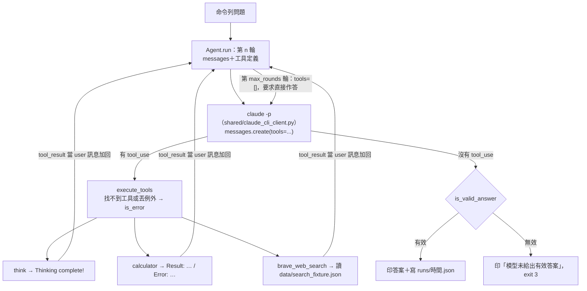

# S1 官方多工具代理（Multi-Tool Agent）

## 1. 模仿哪一章

模仿官方 claude-quickstarts 第 3 章 `agents`。講義在 `~/workspace/kindle-902-claude-quickstarts/lessons/ch03-agents.md`，官方原始碼在 `~/workspace/claude-quickstarts/agents/`（只讀）。

題材照官方筆記本 `agent_demo.ipynb` 的「Multi-Tool Agent」：一個通用助理，有網路搜尋、計算機、思考三種工具，回答「要先查資料、再算數」的問題。問題也照官方原文：

- `What's the square root of the OKC population in 2022`
- `How many bananas will fit in an Toyota GR86?`

程式 `multi_tool_agent.py` 的 `Agent` 類別照官方 `agent.py` 的形狀（`name`、`system`、`tools`、`run(question)`）。迴圈也一樣：呼叫模型，取出 `tool_use` block，執行工具，把 `tool_result` 加回 messages，再呼叫模型，直到模型這一輪沒有要工具為止。

## 2. 三個靈魂拷問

| 問題 | 答案 |
| --- | --- |
| 這個代理是給誰用的？ | 給自己用。在終端機一個人跑，有人看著，目的是看懂工具迴圈怎麼自己決定要查、要想、還是要算。 |
| 被賦予了哪些工具權限？ | **可以用的**：`think`（什麼都不做，只回 `Thinking complete!`）、`calculator`（純計算）、`brave_web_search`（只讀 `data/search_fixture.json`，不上網）。三個工具都沒有副作用。<br>**刻意不給的**：官方 `tools/file_tools.py` 裡的 `file_read`／`file_write`（筆記本沒用到）、上網、執行程式碼、寫檔。`claude -p` 用 `--tools ""` 啟動，模型本身碰不到電腦，工具一律由本程式代為執行。<br>**最壞情況**：模型算錯或引用錯的數字，印在終端機上。 |
| 資料和成果最後存在哪裡？ | 輸入是命令列上的問題。搜尋資料 `data/search_fixture.json` 進 git（內容是官方公開的存檔結果）。答案只印在終端機。迴圈紀錄寫在 `runs/<時間>.json`，內容有問題、每輪的工具名稱與參數、結果長度與首行、呼叫次數、是否為有效答案、答案是否與 calculator 一致。`runs/` 不進版控，也沒有個資。 |

## 3. 架構與資料流



轉接層每次呼叫都是全新的 `claude -p` 行程，會把整串 messages（含 `tool_use`／`tool_result`）攤平成一份逐字稿重送。工具定義寫進系統提示，請模型用 `<tool_use>{...}</tool_use>` 標記回覆，再由轉接層解析成 `tool_use` block。模型是真的，但這不是 API 原生的 tool use。

## 4. 怎麼跑（Git Bash）

```bash
cd ~/workspace/kindle-904-quickstarts-official-samples/s1-multi-tool-agent
PYTHONUTF8=1 python multi_tool_agent.py "What's the square root of the OKC population in 2022"
PYTHONUTF8=1 python multi_tool_agent.py "How many bananas will fit in an Toyota GR86?"
PYTHONUTF8=1 python multi_tool_agent.py --max-rounds 3 "<問題>"   # 觀察碰到上限時的行為
PYTHONUTF8=1 python multi_tool_agent.py --fix-prompt "<問題>"     # 系統提示改成正確工具名 calculator
PYTHONUTF8=1 python multi_tool_agent.py --dry-run "<問題>"        # 不呼叫模型，只檢查程式路徑
PYTHONUTF8=1 python multi_tool_agent.py --selftest                # 離線自我檢查
```

- 不需要任何 API 金鑰，前提是已經登入 Claude Code（Max 訂閱）。要換成較快的模型，可以設 `K902_CLI_MODEL=haiku`。
- `--max-rounds` 預設 6，指的是最多呼叫幾次模型。官方 OKC 題的存檔是 5 次（搜尋、搜尋、think、calculator、回答），多留 1 次餘裕。最後一輪不提供工具，並要求模型根據已有的結果作答。
- 結束碼：0 有效答案｜1 模型呼叫失敗（逾時、超過 `K902_CLI_MAX_CALLS`，不重試）｜2 用法錯誤（例如空問題）｜3 模型未給出有效答案。

## 5. 實際跑出來的結果（2026-11-25，真模型 1 次）

指令：`K902_CLI_MAX_CALLS=6 PYTHONUTF8=1 python multi_tool_agent.py "What's the square root of the OKC population in 2022"`

```text
[Multi-Tool Agent] Tool call: brave_web_search(query=Oklahoma City population 2022 census estimate)
[Multi-Tool Agent] Tool result: Title: Oklahoma Cities by Population (2025) …（共 4148 字）
[Multi-Tool Agent] Tool call: brave_web_search(query=Oklahoma City population July 1 2022 Census Bureau estimate)
[Multi-Tool Agent] Tool result: Title: Oklahoma Cities by Population (2025) …（共 4148 字）
[Multi-Tool Agent] Tool call: calculator(number1=695178, number2=0, operator=sqrt)
[Multi-Tool Agent] Tool result: Result: 833.7733504976037

=== 答案 ===
The square root of Oklahoma City's 2022 population is about **833.77**.
- The 2023 Census estimate for Oklahoma City is **702,767**.
- The Oklahoman reported that the city added **7,589 people** between 2022 and 2023.
- So the 2022 population was about 702,767 − 7,589 = **695,178**.

模型呼叫 4 次（上限 6）｜有效答案：True｜答案與 calculator 一致：True｜耗時 19.6 秒
```

| 項目 | 官方存檔 | 本次實測 |
| --- | --- | --- |
| 步驟 | 搜尋 → 搜尋 → think → calculator → 回答（5 次呼叫） | 搜尋 → 搜尋 → calculator → 回答（4 次呼叫），沒有用 think |
| 2022 人口 | 683,078 × 1.0096² ≈ 696,272（自己推估的成長率） | 702,767 − 7,589 = 695,178（兩筆搜尋結果相減） |
| 答案 | √696,272 ≈ 834.43 | √695,178 ≈ 833.77 |

觀察：

- 同一份搜尋資料，模型這次選了不同的推算方式。兩次都是「推估」，因為存檔資料裡本來就沒有 2022 年的確切數字。
- 模型把 `Oklahoma Cities by Population (2025)` 那筆的 702,767 當成「2023 年人口普查局估計值」。資料標題寫的是 2025，這是模型自己的解讀。
- 答案最後一段還多寫了「最初的 2022 估計約 694,800」。這個數字不在任何工具結果裡，是模型自己知道的知識。
- 第二次搜尋換了查詢字串，但離線假搜尋仍然比對到同一組存檔結果（見第 6 節），所以兩次拿到的內容一樣。
- `--dry-run` 跑同一題：印出 4 個步驟，每步都標 `[dry-run]`，exit 0，沒有啟動 `claude` 子程序。

## 6. 跟官方原版差在哪

| 項目 | 官方 `agents`＋`agent_demo.ipynb` | 本範例 |
| --- | --- | --- |
| 呼叫模型 | `anthropic` SDK＋金鑰，原生 tool use | `shared/claude_cli_client.py`（`claude -p`），用提示詞模擬 tool use |
| 迴圈上限 | `while True`，沒有上限（K902 第 3 章陷阱 1） | `--max-rounds`（預設 6），最後一輪不給工具 |
| 搜尋 | Brave Search MCP 伺服器，真的上網（要 `BRAVE_API_KEY`） | 離線假搜尋，讀官方存檔結果（共 4 組查詢、40 筆，每筆附筆記本行號 `source_line`） |
| 計算機 | Python MCP 伺服器 `calculator_mcp.py` | 同一支程式裡的 Python 函式，簽名、運算子、錯誤字串照官方，不走 MCP 協定 |
| `brave_local_search` | 有註冊，但存檔輸出裡沒呼叫過 | 不提供。系統提示照官方保留這個名稱，模型呼叫時回 `Tool 'brave_local_search' not found` |
| 多個工具呼叫 | `asyncio.gather` 平行 | 依序執行（工具都是瞬間完成的純函式） |
| 歷史截斷 | `MessageHistory.truncate()` 超過 context 就丟最舊的 | 不截斷（最多 6 輪，一題約 10 KB） |
| 伺服器端工具 | 筆記本第 4 節示範 `web_search`、`code_execution`（東京人口密度題） | **沒有對應**：轉接層會忽略沒有 `input_schema` 的工具，本範例不做東京題 |

幾個要照實說的地方：

- **離線搜尋的比對規則是本教材自己訂的，官方沒有載明。** 查詢至少要命中一個主題詞（oklahoma／okc、toyota／gr86、banana），才在同主題的存檔查詢裡挑字詞重疊最多的那組。所以兩次問法不同的 OKC 搜尋，常常拿到同一組 10 筆結果。Brave 實際怎麼排序，報告未載明。
- **問 fixture 沒有的題目**（例如「台北 2022 年人口開根號」），搜尋會回 `No results found.`。規格要求模型這時要說查不到、不能自己編人口數。這個情境本次只做了離線測試，沒有用真模型跑，模型會不會編數字尚未驗證。
- **`calculate` 陷阱**：官方系統提示寫 `calculate`，但實際註冊的名稱是 `calculator`。轉接層只認得已註冊的名稱，所以程式另外用 `recover_unknown_calls` 把 `calculate` 這類名稱撿回來，回傳 `Tool 'calculate' not found`（`is_error`），讓模型自己改正。本次實測模型直接用了正確的 `calculator`，沒有踩到這個陷阱。加 `--fix-prompt` 可以和正確版的提示詞對照。
- **官方未載明**：官方 OKC 題最後的文字答案全文（存檔是逐段串流輸出，沒有逐字核對），以及 Brave 搜尋的實際排序規則。`brave_web_search` 的工具說明文字在 npm 套件裡，不在官方 repo，本範例的說明是自己寫的。

正式上線要改：改用 API 原生 tool use；搜尋改接真的搜尋 API（金鑰放在專案 `.env`）；加上歷史截斷或摘要；檢查模型引用的數字是否真的出現在工具結果裡（本次就出現了工具結果以外的 694,800）。

## 7. 模仿指南：改成自己的需求，改這 3 個地方

1. **`TOOLS` 字典**：每個工具是「給模型看的定義（name、description、input_schema）」加上「一個 Python 函式」。新增工具時兩樣都要有。
2. **`data/search_fixture.json`**：換成你自己的存檔資料（例如公司 FAQ 的搜尋結果），每筆保留 `query`、`title`、`description`、`url`。主題詞要一起改，改 `SUBJECT_WORDS`。
3. **`OFFICIAL_SYSTEM_PROMPT`**：改掉代理的角色。提示詞裡寫的工具名稱，一定要和 `TOOLS` 的名稱對得起來，不要重蹈 `calculate` 的覆轍。
