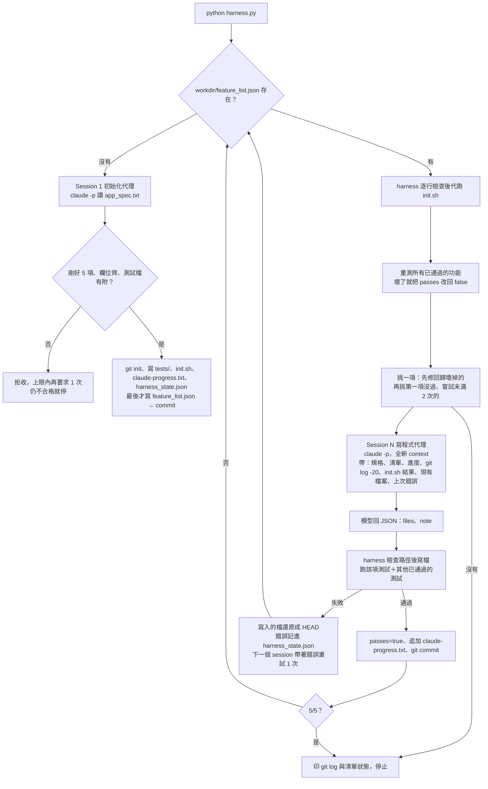

# S3　官方 autonomous-coding 縮小版：讓代理接力寫出 claude.ai 複製品的「對話管理」資料層

## 1. 模仿官方哪一章

- 對應官方 `claude-quickstarts/autonomous-coding`，導讀在 K902 講義 `~/workspace/kindle-902-claude-quickstarts/lessons/ch10-autonomous-coding.md`。
- 題材照官方：官方 `prompts/app_spec.txt` 是 claude.ai 複製品（679 行、200 項功能）。本範例只取官方規格自己切好的 `implementation_steps` 第 3 步「Conversation Management」（第 556～567 行），做成 5 項功能的 SQLite 資料層 `chat_store.py`。縮小版規格存在 `app_spec.txt`，沿用官方 XML 標籤，開頭註明出處。
- 一句話：初始化代理把 `app_spec.txt` 切成 5 項功能，寫好驗收測試和 `init.sh`；寫程式代理每個 session 先重測已通過的功能，再只做一項；harness 驗收、commit、寫交接。中斷後重跑同一條指令就接著做。

| 功能 | 官方規格原文 | 本範例的介面 |
| --- | --- | --- |
| F1 | Create new conversations／Conversation list in sidebar | `create_conversation`、`add_message`、`get_conversation`、`list_conversations`（`updated_at` 新到舊） |
| F2 | Rename conversations | `rename_conversation`（同時更新 `updated_at`） |
| F3 | Delete conversations（schema 有 `is_deleted`） | `delete_conversation`（軟刪除，列表與搜尋不再出現） |
| F4 | Search conversations by title/content | `search_conversations`（`%`、`_`、`\` 照字面比對，中文可搜） |
| F5 | grouped by date: Today, Yesterday, Previous 7 days, etc. | `group_by_date(conversations, now)`；第四組 `Older` 是自訂（官方只寫 etc.） |

## 2. 三個靈魂拷問

| 問題 | 回答 |
| --- | --- |
| 做給誰用 | 給想對照官方原版、學「長時間任務怎麼分 session 接力」的自己，在終端機看著它跑。產出的 `chat_store.py` 是練習品，不對外、不上線。 |
| 工具權限 | **模型本身沒有任何工具**（`claude -p --tools ""`），只回 JSON（要寫哪些檔、內容是什麼）。寫檔、跑測試、跑 `init.sh`、commit 都由 harness 代做。<br>**harness 的護欄**：只准寫進 `workdir/`，擋 `..`、絕對路徑、`.git/`；`feature_list.json`、`claude-progress.txt`、`harness_state.json`、`app_spec.txt` 只有 harness 能寫；初始化代理只能寫 `tests/` 與 `init.sh`，寫程式代理不能改 `tests/`、`init.sh`；驗收指令只接受 `python -m unittest tests.<模組>`，不經 shell，60 秒逾時；`init.sh` 由初始化代理寫，但每一行都要通過白名單（`echo`、`python --version`、`python -m unittest`）harness 才逐行代跑，否則整份不跑（對照官方 `security.py` 第 44 行 init.sh 需額外檢查）。<br>**刻意不給**：不上網、不呼叫 Claude API、不讀任何金鑰檔；每項最多嘗試 2 次，一次執行最多呼叫模型 10 次。 |
| 資料與成果 | 全部在 `s3-long-running/workdir/`（獨立 git repo）：`app_spec.txt` 副本、`feature_list.json`、`claude-progress.txt`、`init.sh`、`tests/`、`chat_store.py`、git 歷史，以及 harness 專用的 `harness_state.json`（嘗試次數、上次錯誤）。測試用的 SQLite 在記憶體或暫存資料夾，測完即刪。外層 repo 的 `.gitignore` 排除 `workdir/`、`workdir.bak-*/`、`logs/`；5/5 完成版另存成進版控的 `snapshot-5of5/`。示範資料 `sample-conversations.json` 是虛構的，無個資。 |

用 `claude -p` 還是 API：只有自己用、量小（一次執行預期 6 次呼叫），失敗重跑即可，所以用 `claude -p`（訂閱額度）。

## 3. 架構與資料流



session 之間唯一的橋樑是 `workdir/` 裡的交接檔，和官方一樣：`feature_list.json`（還剩哪些功能，只能改 `passes`）、`claude-progress.txt`（上一個 session 做了什麼）、git 歷史（存檔點）。本範例多一個 `harness_state.json` 記嘗試次數，讓清單維持官方的形狀。

## 4. 怎麼跑（Git Bash）

```bash
cd ~/workspace/kindle-904-quickstarts-official-samples/s3-long-running
PYTHONUTF8=1 python harness.py --selftest                       # 離線檢查路徑、指令白名單、init.sh 檢查，不呼叫模型
rm -rf workdir                                                   # 想從頭來才需要
PYTHONUTF8=1 python harness.py                                   # 預設 --max-sessions 3 --max-calls 10
PYTHONUTF8=1 python harness.py                                   # 同一條指令再跑一次＝續跑
PYTHONUTF8=1 python harness.py --max-sessions 6 --max-calls 10   # 一次跑完
PYTHONUTF8=1 python harness.py --dry-run --workdir logs/dry-run-workdir   # 乾跑（假回覆取自 snapshot-5of5），不算演練
cd workdir && PYTHONUTF8=1 python -m unittest discover -s tests   # 全部驗收測試
```

| 參數 | 說明 | 預設 |
| --- | --- | --- |
| `--max-sessions N` | 這次最多跑幾個 session | 3 |
| `--max-calls N` | 這次最多呼叫模型幾次 | 10 |
| `--workdir PATH` | 產出資料夾 | `workdir/`（乾跑時 `logs/dry-run-workdir`） |
| `--dry-run` | 不呼叫模型，用 `snapshot-5of5/` 當寫死的假回覆走完流程；畫面標明【乾跑模式】；拒絕寫進真正的 `workdir/` | 關 |
| `--selftest` | 離線單元檢查 | 關 |

模型用 Claude Code 的預設模型，要換就設 `K902_CLI_MODEL=haiku`。harness 把單次逾時設成 300 秒（`K902_CLI_TIMEOUT`）。

**新電腦先看這裡**：`workdir/` 不進版控，clone 下來時不存在。要演練或查看 5/5 完成版，不必重跑 harness，從快照重建即可（不呼叫模型）：

```bash
cd ~/workspace/kindle-904-quickstarts-official-samples/practice/interactive
bash s3.sh seed      # 複製 snapshot-5of5 → workdir，git init，一個 commit（workdir 已存在就什麼都不做）
```

互動演練：`bash s3.sh 1` … `bash s3.sh 8`、`bash s3.sh 8b`，教練稿在 `practice/interactive/coach-s3.txt`。

## 5. 實際跑出來的結果（2026-11-25，真模型 `claude -p`）

完整紀錄在 `logs/run1.txt`～`run3.txt`（不進版控）。

第 1 次，從空的 workdir 開始，預設 3 個 session，約 1 分 40 秒：

```text
Session 1：初始化代理（讀 app_spec.txt → feature_list.json、tests/、init.sh）
  → 功能 5 項：F1, F2, F3, F4, F5 → commit 6bd621b
Session 2：處理功能 F1 建立對話、新增訊息、取得對話，以及依 updated_at 由新到舊列出側邊欄對話清單。…
  → 測試結果：通過 → commit 39be2eb
Session 3：處理功能 F2 重新命名對話。測試驗證 rename_conversation 會 strip 標題、更新 updated_at…
  → 測試結果：通過 → commit 0f8aa06

本次模型呼叫：3 次（上限 10）
== feature_list.json 狀態：2/5 ==
```

第 2 次，同一條指令，從 Session 4 接著做（每個 session 先重測已通過的功能），約 1 分鐘：

```text
Session 4：處理功能 F3 軟刪除對話。…            → 測試結果：通過 → commit 925f1ab
Session 5：處理功能 F4 依標題或訊息內容搜尋對話。… → 測試結果：通過 → commit 38251ce
Session 6：處理功能 F5 依日期分組對話清單。…      → 測試結果：通過 → commit dbbd407
全部通過：5/5，停止（官方原版沒有這個判斷）

本次模型呼叫：3 次（上限 10）
== git log --oneline ==
dbbd407 完成 F5：依日期分組對話清單。…
38251ce 完成 F4：依標題或訊息內容搜尋對話。…
925f1ab 完成 F3：軟刪除對話。…
0f8aa06 完成 F2：重新命名對話。…
39be2eb 完成 F1：建立對話、新增訊息、取得對話，…
6bd621b Initial setup: feature_list.json, init.sh, and project structure（初始化）
== feature_list.json 狀態：5/5 ==
```

第 3 次再跑，不呼叫模型：`沒有可做的功能了：已完成 5/5 項`、`本次模型呼叫：0 次`。

- 兩次執行合計呼叫模型 **6 次**（初始化 1＋五項各 1），符合規格預期；上限是單次 10、合計 12。
- 初始化代理寫了 5 個測試模組共 49 個測試（`tests/test_f1.py`～`test_f5.py`），`python -m unittest discover -s tests` 全部通過。
- 5 項都是第一次就通過，所以「拒收後重要求」「失敗後帶錯誤重試」「回歸壞掉改回 false」這三條路徑在真模型實跑中**沒有被觸發**；它們另外用離線假回覆驗證過（selftest，以及在暫存資料夾故意弄壞 `chat_store.py`：回歸測試把 F1～F3、F5 改回 false，修好 F1 後其餘重測恢復）。
- 真模型實跑之後，harness 補了一項小改動：回歸壞掉的其他功能，在目標功能修好後會自動重測一次，恢復就標回通過。這條路徑真模型實跑沒走到。
- `init.sh` 是初始化代理寫的，內容只有 `echo`、`python --version`、`python -m unittest discover -s tests`，全部通過白名單，每個寫程式 session 都由 harness 逐行代跑。

用代理寫出的 `chat_store.py` 跑示範資料（`sample-conversations.json`，現在＝2026-11-25 10:00，互動演練第 7 步）：

```text
【F4】search_conversations（刪除前）
  '50%'      → ['要刪除的測試對話', '折扣怎麼算']        ← 「50 percent」那筆沒命中
  '_'        → ['SQL LIKE 的 _ 萬用字元']
  '太魯閣'   → ['花蓮三天兩夜行程']
【F5】group_by_date
  Today            ['長時間代理讀書心得（2026-11-25）', '花蓮三天兩夜行程（2026-11-25）']
  Yesterday        ['折扣怎麼算（2026-11-24）']             ← 23:59 跨午夜
  Previous 7 days  ['SQL LIKE 的 _ 萬用字元（2026-11-20）']
  Older            ['上個月的會議紀錄（2026-11-10）']
```

## 6. 跟官方原版差在哪

| 項目 | 官方 autonomous-coding | 本範例 |
| --- | --- | --- |
| 題材與規模 | claude.ai 複製品，至少 200 項，React＋Express＋SQLite，要跑 many hours | 同一份規格的第 3 步，5 項，Python `sqlite3` 資料層 |
| 模型怎麼呼叫 | Claude Agent SDK，要 `ANTHROPIC_API_KEY`（規格本身還要 Claude API 金鑰） | `claude -p`，透過 `shared/llm_agent.py`，不設任何金鑰 |
| 模型的權限 | Read、Write、Bash、Puppeteer，靠沙箱、`./**` 限制、Bash 允許清單 hook | 沒有任何工具，只回 JSON；寫檔、跑指令都由 harness 代做 |
| 驗收 | Puppeteer 瀏覽器截圖 | `python -m unittest tests.test_fN` |
| 交接檔 | `app_spec.txt`、`feature_list.json`、`claude-progress.txt`、`init.sh`、git | 同名同用途；另加 `harness_state.json` |
| 清單防竄改 | 只靠提示詞「只能改 passes」（陷阱 2） | 清單只有 harness 能寫；`tests/` 鎖住 |
| 回歸測試 | 提示詞第 3 步叫模型重測 1～2 條 | harness 每個 session 重測全部已通過的，壞了自動改回 false |
| 何時停 | 只看 `max_iterations`（陷阱 1） | 全部通過就停；另有 `--max-calls` |
| 重試 | 出錯就開新 session，次數不限 | 每項最多 2 次，用完標 GAVE-UP |
| 初始化中斷 | 會被當成接續（陷阱 6） | `feature_list.json` 最後才寫，先寫暫存檔再改名 |
| `init.sh` | 模型自己跑，另有額外檢查 | 模型寫、harness 逐行白名單檢查後代跑 |

**正式上線要改什麼**：

1. 驗收指令要放進真正的沙箱（容器或低權限帳號）。目前只過白名單，被測的 Python 程式本身仍能存取整台電腦。
2. 初始化代理寫的測試要先由人審一次。測試寫錯，後面的功能就永遠過不了，或用錯的行為過關。
3. 專案變大後不能把所有檔案塞進提示詞（目前上限 4 萬字），要改成讓模型用工具按需讀檔。
4. 每次嘗試前開分支，失敗就丟掉，比現在的「還原寫入的檔」更乾淨。

## 7. 模仿指南：改成自己的需求，改這 3 個地方

1. **`app_spec.txt`**：換成你要的規格。一定要寫清楚 `<interface>`（檔名、方法名、回傳格式、例外），因為測試和實作由不同 session 寫，靠它對齊。想換官方規格的其他步驟（例如第 4 步 Artifacts），就照它的 tasks 改 `core_features`。
2. **`harness.py` 的 `INIT_PROMPT` 與 `FEATURE_COUNT`**：改功能數量與測試要求。換測試框架時，`parse_test_command` 與 `check_init_sh` 的白名單要一起改。
3. **`harness.py` 的 `CODE_PROMPT`**：改寫程式代理的規則，例如允許的套件、程式風格、交接筆記要寫什麼。
